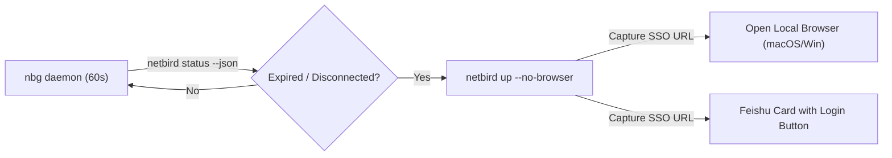

<div align="center">


# nbg

**Keep NetBird alive across macOS, Linux, and Windows.**

Silent by default — triggers only when your session expires or disconnects.

<p>
  <a href="https://github.com/frenude/netbird-guard/releases/latest"></a>
  <a href="LICENSE"></a>
  
  
</p>

**English** · [简体中文](README_ZH.md)

</div>

---

## Why nbg?

| | |
|---|---|
| **Zero Noise** | Completely silent while healthy. Alerts only when NetBird actually expires or disconnects (`renew_before_secs = 0`). |
| **Auto Browser Login** | Automatically opens the SSO login page on macOS & Windows with built-in cooldown to prevent tab spam. |
| **Direct Feishu Push** | Sends interactive Feishu login cards directly from your device (Group Webhook or Enterprise App DM) — **no relay server needed**. |
| **Tiny Rust Binary** | ~3 MB single binary, zero runtime dependencies, one-command `launchd` / `systemd` background service. |



---

## Quick Start

### macOS & Linux

```bash
curl -fsSL https://raw.githubusercontent.com/frenude/netbird-guard/main/install.sh | sh
```

Automatically detects `arm64` / `x86_64`, installs `nbg` from [GitHub Releases](https://github.com/frenude/netbird-guard/releases/latest), creates `~/.config/nbg/config.toml`, and starts the background daemon.

<details>
<summary><strong>Windows &amp; Build from Source</strong></summary>

- **Windows**: Download `nbg-windows-x86_64.exe` from [GitHub Releases](https://github.com/frenude/netbird-guard/releases/latest).
- **From Source**:
  ```bash
  git clone https://github.com/frenude/netbird-guard.git
  cd netbird-guard && cargo build --release
  ```

</details>

---

## Feishu Setup (Optional)

Edit `~/.config/nbg/config.toml` and pick **either** option:

```toml
[feishu]
# Option A · Group Bot Webhook (simplest)
webhook_url = "https://open.feishu.cn/open-apis/bot/v2/hook/your-hook"
secret = ""

# Option B · Enterprise App Direct DM (requires im:message:send_as_bot)
app_id = "cli_xxxxxxxxxxxx"
app_secret = "xxxxxxxxxxxxxxxxxxxx"
receive_open_id = "ou_xxxxxxxxxxxxxxxx"
```

Or pass credentials inline during installation:

```bash
curl -fsSL https://raw.githubusercontent.com/frenude/netbird-guard/main/install.sh | \
  FEISHU_WEBHOOK_URL="https://open.feishu.cn/open-apis/bot/v2/hook/your-hook" sh
```

Test it anytime:

```bash
nbg test
```

---

## Commands

| Command | Description |
|---|---|
| `nbg status` | Show NetBird status, FQDN, IP, and session expiry |
| `nbg test` | Send a test Feishu notification card |
| `nbg check` | Trigger a single check immediately |
| `nbg install` | Install and start background daemon (`launchd` / `systemd`) |
| `nbg uninstall` | Stop and remove background daemon |

<details>
<summary><strong>All Config Options (~/.config/nbg/config.toml)</strong></summary>

| Key | Default | Description |
|---|---|---|
| `device_name` | `""` | Custom device name (defaults to hostname) |
| `check_interval_secs` | `60` | Poll interval in seconds |
| `renew_before_secs` | `0` | Proactive refresh window (`0` = expiry/disconnect only) |
| `notify_cooldown_secs` | `1800` | Cooldown between repeated notifications |
| `login_wait_timeout_secs` | `300` | Max wait for SSO completion |
| `auto_open_browser` | `true` (macOS) | Open SSO link automatically in browser |
| `notify_on_recovery` | `false` | Send a Feishu card after reconnection |

</details>

---

<div align="center">
  MIT License © 2026 <a href="https://github.com/frenude">Frenude</a>
</div>
