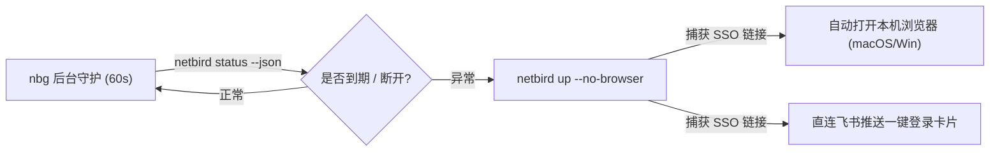

<div align="center">


# nbg

**轻量跨平台 Rust 守护进程，让 NetBird 永不静默掉线。**

平时完全静音，仅在 NetBird 会话到期或断开时主动唤醒登录。

<p>
  <a href="https://github.com/frenude/netbird-guard/releases/latest"></a>
  <a href="LICENSE"></a>
  
  
</p>

[English](README.md) · **简体中文**

</div>

---

## 为什么用 nbg？

| | |
|---|---|
| **平时零打扰** | 连接正常时完全静音，默认仅在 NetBird 真正到期或断开时才触发通知（`renew_before_secs = 0`）。 |
| **自动弹出浏览器** | macOS / Windows 检测到过期后自动拉起默认浏览器直达 SSO 登录页，内置冷却防刷屏。 |
| **纯本地直连飞书** | 支持飞书群 **Webhook** 或 **企业自建应用私聊**，直接推送带「点击登录」按钮的交互卡片，**无需中转服务器**。 |
| **3 MB 单文件** | 纯 Rust 编译、零运行时依赖，一条命令托管到 `launchd` / `systemd` 开机自启。 |



---

## 快速安装

### macOS & Linux

```bash
curl -fsSL https://raw.githubusercontent.com/frenude/netbird-guard/main/install.sh | sh
```

自动识别 `arm64` / `x86_64`，从 [GitHub Releases](https://github.com/frenude/netbird-guard/releases/latest) 下载预编译二进制，生成 `~/.config/nbg/config.toml` 并启动开机自启后台服务。

<details>
<summary><strong>Windows 下载 &amp; 源码编译</strong></summary>

- **Windows**：前往 [GitHub Releases](https://github.com/frenude/netbird-guard/releases/latest) 直接下载 `nbg-windows-x86_64.exe`。
- **源码编译**：
  ```bash
  git clone https://github.com/frenude/netbird-guard.git
  cd netbird-guard && cargo build --release
  ```

</details>

---

## 配置飞书推送（可选）

编辑 `~/.config/nbg/config.toml`，以下两种方式**二选一**：

```toml
[feishu]
# 方式 A · 飞书群自定义机器人 Webhook（最简单）
webhook_url = "https://open.feishu.cn/open-apis/bot/v2/hook/你的hook"
secret = ""

# 方式 B · 飞书企业自建应用私聊（需开通 im:message:send_as_bot 权限）
app_id = "cli_xxxxxxxxxxxx"
app_secret = "xxxxxxxxxxxxxxxxxxxx"
receive_open_id = "ou_xxxxxxxxxxxxxxxx"
```

也可以在安装时通过环境变量一次性注入：

```bash
curl -fsSL https://raw.githubusercontent.com/frenude/netbird-guard/main/install.sh | \
  FEISHU_WEBHOOK_URL="https://open.feishu.cn/open-apis/bot/v2/hook/你的hook" sh
```

验证飞书推送：

```bash
nbg test
```

---

## 常用命令

| 命令 | 说明 |
|---|---|
| `nbg status` | 查看 NetBird 连接状态、FQDN、内网 IP 与剩余有效期 |
| `nbg test` | 发送一条测试卡片到飞书，验证配置 |
| `nbg check` | 立即执行一次状态检查 |
| `nbg install` | 安装并启动开机自启后台服务（`launchd` / `systemd`） |
| `nbg uninstall` | 停止并卸载后台守护服务 |

<details>
<summary><strong>完整配置项说明 (~/.config/nbg/config.toml)</strong></summary>

| 字段 | 默认值 | 说明 |
|---|---|---|
| `device_name` | `""` | 自定义设备名（留空自动使用 hostname） |
| `check_interval_secs` | `60` | 轮询间隔（秒） |
| `renew_before_secs` | `0` | 提前续期窗口（`0` 表示仅到期/断开时通知） |
| `notify_cooldown_secs` | `1800` | 未完成登录时的重复通知冷却时间（秒） |
| `login_wait_timeout_secs` | `300` | 等待浏览器完成 SSO 认证超时时间（秒） |
| `auto_open_browser` | `true` (macOS) | 是否自动打开本机浏览器 |
| `notify_on_recovery` | `false` | 恢复连接后是否再发一条飞书通知 |

</details>

---

<div align="center">
  MIT License © 2026 <a href="https://github.com/frenude">Frenude</a>
</div>
